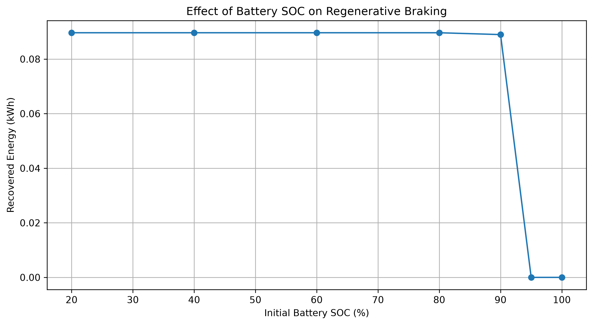
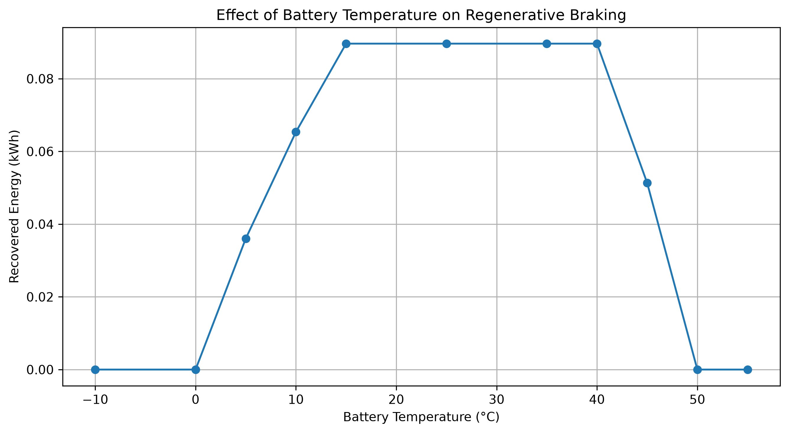
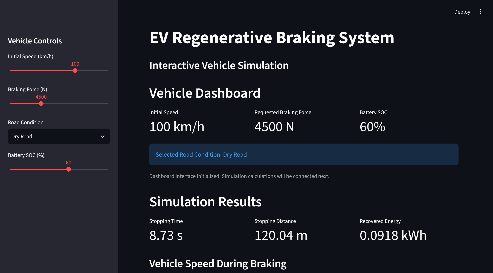
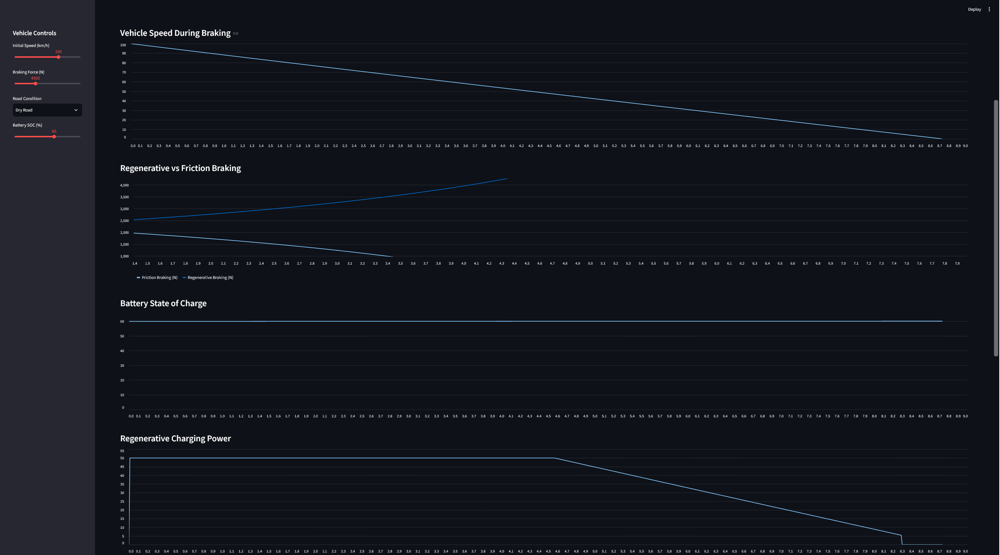
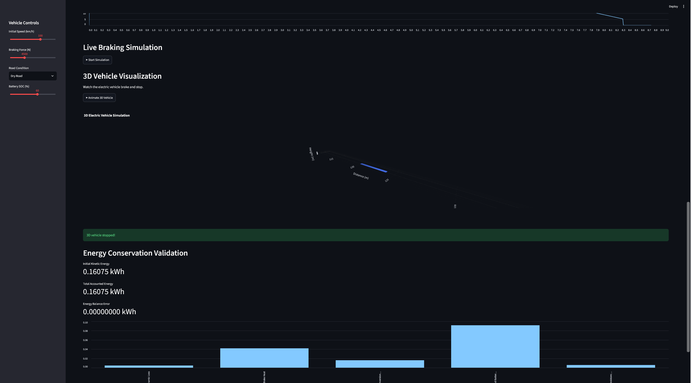
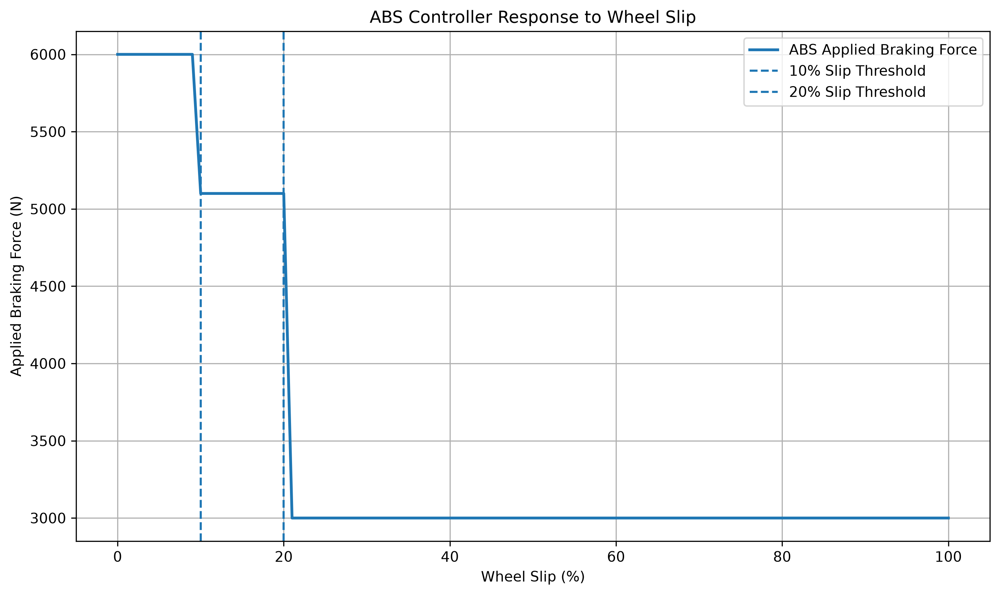
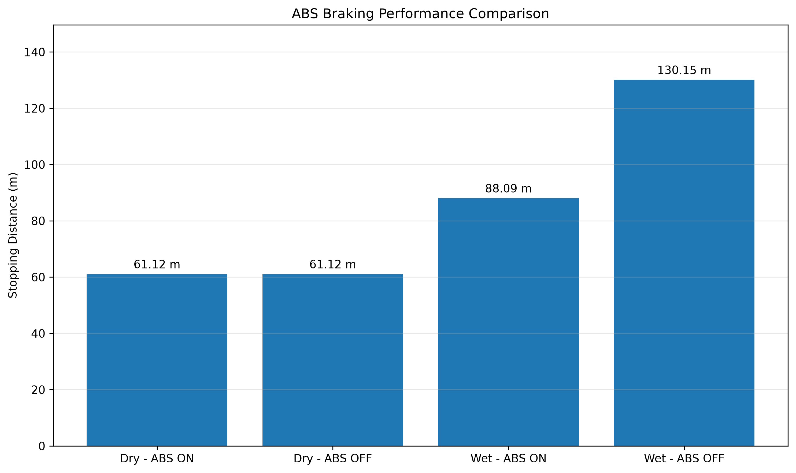
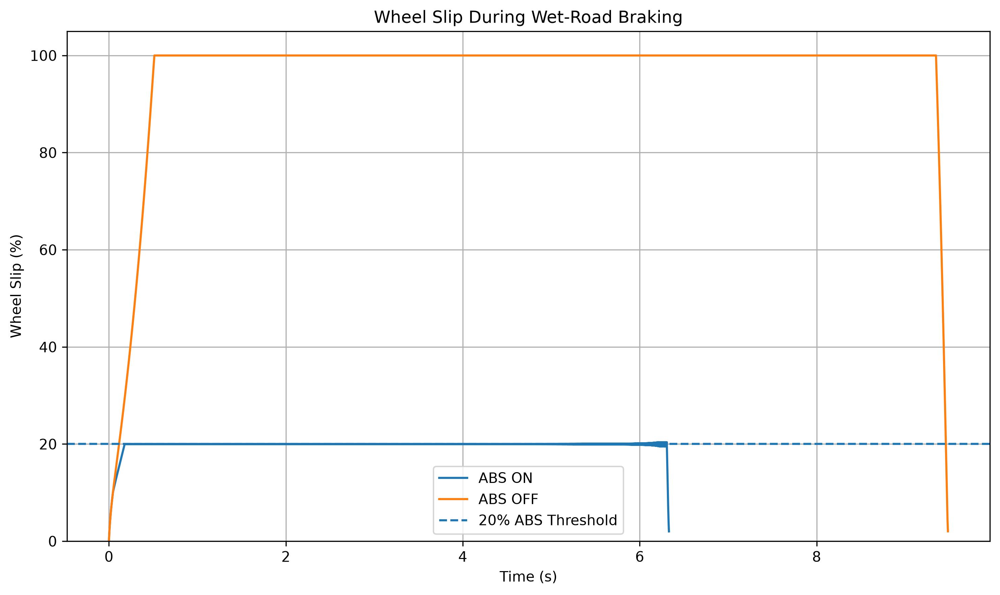
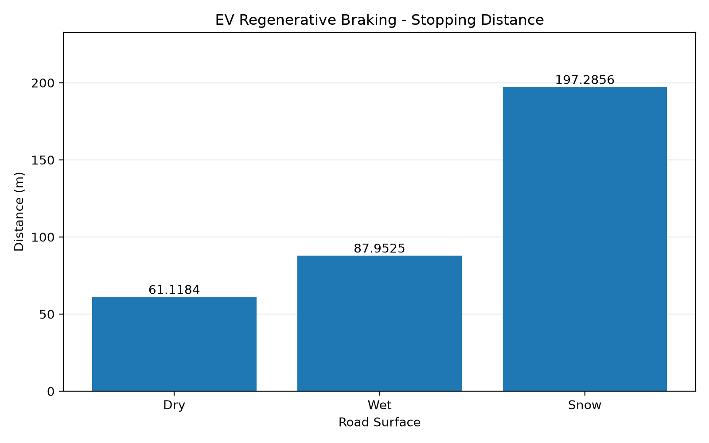
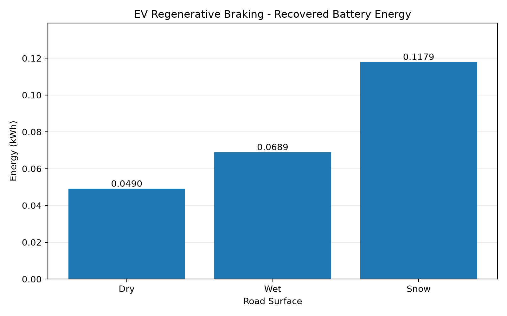

# EV Regenerative Braking System Simulation

### Python | Vehicle Dynamics | Electric Vehicles | Mechatronics Engineering

An interactive, physics-based engineering simulation of an electric vehicle's regenerative braking system, developed using Python, Streamlit, Matplotlib, and Plotly.

## Project Overview

This project investigates the longitudinal braking dynamics and energy recovery performance of an electric vehicle under different operating conditions.

The simulation models the interaction between regenerative braking, mechanical friction braking, tire-road traction, electric motor efficiency, and battery charging limitations.

The primary engineering objectives are to:

- Analyze vehicle stopping time and stopping distance.
- Evaluate regenerative and friction braking force distribution.
- Calculate recovered electrical energy during deceleration.
- Investigate the influence of battery state of charge (SOC) and temperature on regenerative braking.
- Quantify energy losses and verify numerical energy conservation.
- Visualize simulation results through an interactive engineering dashboard.

The project is intended as an educational engineering simulation and portfolio demonstration, rather than a production-ready vehicle braking controller.

## Key Features

### Vehicle Dynamics
- Longitudinal vehicle braking simulation.
- Dry-road and wet-road traction limits.
- Aerodynamic drag and rolling resistance.
- Vehicle speed, deceleration, and stopping distance calculations.

### Regenerative Braking
- Regenerative and friction braking force distribution.
- Motor braking force constraints.
- Speed-dependent electric motor efficiency.
- Battery charging power limitation.

### Battery Management
- Battery state-of-charge tracking.
- Regenerative charging protection at high SOC.
- Temperature-dependent regenerative charging limits.
- Battery SOC and temperature sensitivity analysis.

### Energy Analysis
- Recovered battery energy calculation.
- Friction braking energy loss.
- Aerodynamic and rolling resistance energy losses.
- Motor conversion losses.
- Numerical energy conservation verification.
- Regenerative braking efficiency analysis.

### Visualization and Validation
- Interactive Streamlit dashboard.
- Animated 3D vehicle visualization using Plotly.
- Vehicle speed and braking force graphs.
- Battery power and SOC graphs.
- Energy distribution visualization.
- Performance and sensitivity analysis graphs.
- 119 automated tests passing using Python unittest, including numerical convergence, energy conservation, input validation, and reproducibility.

## Mathematical Model

The simulation uses a simplified longitudinal vehicle dynamics model with numerical time stepping.

### 1. Vehicle Kinetic Energy

The kinetic energy of the moving vehicle is:

\[
E_k = \frac{1}{2}mv^2
\]

Where:
- \(m\) = vehicle mass (kg)
- \(v\) = vehicle velocity (m/s)

### 2. Tire-Road Traction Limit

The maximum available longitudinal tire-road force is approximated by:

\[
F_{\max} = \mu mg
\]

Where:
- \(\mu\) = tire-road friction coefficient
- \(g\) = gravitational acceleration (m/s²)

The model uses different friction coefficients for dry and wet roads.

### 3. Longitudinal Vehicle Deceleration

The vehicle's deceleration magnitude is calculated from:

\[
a = \frac{F_{\text{regen}} + F_{\text{friction}} + F_{\text{drag}} + F_{\text{rolling}}}{m}
\]

Regenerative and friction braking share the braking demand, subject to traction and component limitations.

### 4. Regenerative Charging Power

The electrical power delivered to the battery is approximated by:

\[
P_{\text{battery}} = F_{\text{regen}}v\eta
\]

Where:
- \(F_{\text{regen}}\) = regenerative braking force (N)
- \(\eta\) = speed-dependent motor conversion efficiency

### 5. Battery Protection

The regenerative charging capability depends on battery state of charge and temperature.

The simplified controller:
- Reduces regenerative charging near the upper SOC limit.
- Disables regenerative charging at or above 95% SOC.
- Reduces charging capability at low and high battery temperatures.
- Disables regenerative charging at or below 0°C and at or above 50°C.

These thresholds are assumptions of this educational model, not universal electric vehicle specifications.

### 6. Energy Conservation

The simulation accounts for the initial vehicle kinetic energy through recovered electrical energy and modeled losses:

\[
E_{\text{initial}} =
E_{\text{battery}} +
E_{\text{friction}} +
E_{\text{drag}} +
E_{\text{rolling}} +
E_{\text{motor loss}}
\]

The numerical energy balance error is calculated as:

\[
E_{\text{error}} =
E_{\text{initial}} -
E_{\text{accounted}}
\]

This provides a consistency check on the simulation's energy accounting.

### 7. Energy Recovery Efficiency

The overall energy recovery efficiency for a braking event is defined as:

\[
\eta_{\text{recovery}} =
\frac{E_{\text{battery}}}{E_{\text{initial}}}
\times 100\%
\]

This efficiency includes the effects of regenerative braking limitations, friction braking, road loads, and motor conversion losses.

## Engineering Validation

The simulation includes 119 automated tests covering vehicle stopping behavior, road traction, regenerative braking restrictions, battery protection, motor efficiency, and energy conservation.

The tests are implemented using Python's built-in `unittest` framework.

Run the tests:

```powershell
.\.venv\Scripts\python.exe -m unittest test_vehicle_dynamics -v
```

**Latest validation status:** 9 tests passed.

### Reference Simulation

The following results were obtained using these operating conditions:

| Parameter | Value |
|---|---|
| Initial vehicle speed | 100 km/h |
| Requested braking force | 4,500 N |
| Road condition | Dry |
| Initial battery SOC | 60% |
| Battery temperature | 25°C |
| Vehicle mass | 1,500 kg |

### Energy Balance Results

| Energy component | Energy (kWh) |
|---|---:|
| Initial vehicle kinetic energy | 0.1608 |
| Recovered battery energy | 0.0897 |
| Friction braking loss | 0.0463 |
| Aerodynamic drag loss | 0.0048 |
| Rolling resistance loss | 0.0059 |
| Motor conversion loss | 0.0141 |
| Total accounted energy | 0.1608 |

**Energy recovery efficiency:** approximately 55.77%.

The reported numerical energy balance error was approximately 0.000000 kWh at the displayed precision.

This confirms internal consistency of the model's energy accounting for the reference simulation. It does not constitute experimental validation of a real vehicle.

### Battery SOC Sensitivity

At 100 km/h, 4,500 N braking force, and 25°C:

| Initial SOC | Recovered energy |
|---|---:|
| 20% | 0.0897 kWh |
| 40% | 0.0897 kWh |
| 60% | 0.0897 kWh |
| 80% | 0.0897 kWh |
| 90% | 0.0890 kWh |
| 95% | 0.0000 kWh |
| 100% | 0.0000 kWh |



### Battery Temperature Sensitivity

At 100 km/h, 4,500 N braking force, and 60% initial SOC:

| Battery temperature | Recovered energy |
|---|---:|
| -10°C | 0.0000 kWh |
| 0°C | 0.0000 kWh |
| 5°C | 0.0360 kWh |
| 10°C | 0.0654 kWh |
| 15°C | 0.0897 kWh |
| 25°C | 0.0897 kWh |
| 35°C | 0.0897 kWh |
| 40°C | 0.0897 kWh |
| 45°C | 0.0513 kWh |
| 50°C | 0.0000 kWh |
| 55°C | 0.0000 kWh |



These results demonstrate the expected response of the implemented battery protection rules. The sensitivity studies are simulation-based and have not been calibrated against experimental battery data.
## Technologies Used

- Python
- NumPy
- Pandas
- Matplotlib
- SciPy
- Streamlit
- Plotly
- Python unittest

## Installation

Clone the repository and enter the project directory.

Create and activate a Python virtual environment, then install the project dependencies:

```bash
python -m venv .venv
```

Windows:

```powershell
.\.venv\Scripts\python.exe -m pip install -r requirements.txt
```

Run the interactive dashboard:

```powershell
.\.venv\Scripts\python.exe -m streamlit run dashboard.py
```

Run the automated tests:

```powershell
.\.venv\Scripts\python.exe -m unittest discover -v
```

## Model Limitations

This project is an educational engineering simulation, not a production-ready automotive braking controller.

The current model has the following limitations:

- **Longitudinal dynamics only:** Lateral vehicle motion, yaw dynamics, and load transfer are not modeled.
- **Simplified tire-road interaction:** Tire traction is represented using a friction coefficient rather than a nonlinear tire model.
- **No ABS or wheel-slip controller:** Individual wheel speeds, slip ratios, and anti-lock braking control are not implemented.
- **Simplified battery thermal protection:** Battery temperature is treated as a fixed simulation input. The model limits regenerative charging based on temperature but does not simulate battery heating or cooling over time.
- **Simplified motor efficiency:** Motor efficiency is approximated using speed-dependent values rather than experimentally measured torque-speed efficiency maps.
- **No experimental calibration:** Model parameters and results have not been validated against measurements from a physical electric vehicle.

These limitations define the scope of the simulation and provide opportunities for further engineering development.

## Future Development

Planned improvements include:

- Wheel-slip dynamics and anti-lock braking system (ABS) simulation.
- Electronic brake-force distribution and advanced regenerative braking control.
- Dynamic battery thermal modeling.
- Motor torque-speed and efficiency maps.
- Vehicle parameter configuration for different EV architectures.
- Comparison against experimental vehicle braking data.
- Expanded automated testing and numerical convergence analysis.
- Improved interactive visualization of braking and energy recovery performance.

## Project Category

Mechatronics Engineering | Automotive Engineering | Electric Vehicle Systems | Modeling and Simulation

## Project Screenshots

### Interactive EV Dashboard


### Braking Performance Graphs


### 3D Vehicle Visualization


## Stage 24 — Anti-lock Braking System (ABS)

This stage extends the regenerative braking project with a simplified quarter-car Anti-lock Braking System (ABS) simulation.

### Implemented Features

- Wheel rotational dynamics and longitudinal slip calculation
- Simplified threshold-based ABS brake-force controller
- Nonlinear tire-road friction model for dry and wet roads
- ABS ON/OFF stopping-distance comparison
- Wheel-slip analysis and visualization
- Streamlit dashboard integration
- Automated ABS system tests

### Simulation Results

Initial vehicle speed: 100 km/h

| Road | ABS | Stopping Distance | Stopping Time |
|------|-----|-------------------|---------------|
| Dry | ON | 61.12 m | 4.39 s |
| Dry | OFF | 61.12 m | 4.39 s |
| Wet | ON | 88.09 m | 6.33 s |
| Wet | OFF | 130.14 m | 9.48 s |

For the simulated wet-road scenario, ABS reduced stopping distance by approximately 42.05 m (32.3%).

Maximum reported wheel slip:
- ABS ON: 20.4%
- ABS OFF: 100%

### ABS Analysis Graphs







### Engineering Limitations

The ABS model uses simplified threshold-based brake control and quarter-car dynamics.

The reported performance is specific to the chosen model parameters and does not establish real-world vehicle performance.

The ABS and regenerative braking simulations are currently separate models; coordinated regenerative/friction braking control is not yet implemented.
## Engineering Results

### Reference Simulation

The reference simulation uses:
- Initial vehicle speed: 100 km/h
- Initial battery SOC: 60%
- Hybrid predictive PI ABS controller
- Adaptive regenerative/friction braking
- Enhanced tire-road friction model
- Grip-based brake initialization
- Actuator response time: 50 ms
- Prediction horizon: 30 ms

### Braking Performance

| Road condition | Stopping distance | Stopping time | Recovered energy |
|---|---:|---:|---:|
| Dry | 61.118 m | 4.388 s | 0.049036 kWh |
| Wet | 87.953 m | 6.313 s | 0.068893 kWh |
| Snow | 197.286 m | 14.180 s | 0.117933 kWh |

These results are from the software simulation,
not experimental vehicle measurements.

The longer stopping duration on low-grip roads
can increase total regenerative energy recovery
under the modeled conditions.

### Simulation Performance

The numerical solver uses a reference time step
of 0.0001 seconds.

Numerical convergence, energy conservation,
and simulation reproducibility were verified
through automated testing.

### Automated Validation

- 119 automated tests passed
- 0 failures
- Final validation execution time: 20.566 seconds
- Tested across dry, wet, and snow road conditions

### Engineering Documentation

- [Technical Documentation](TECHNICAL_DOCUMENTATION.md)
- [Final Engineering Validation Report](STAGE52_VALIDATION_REPORT.md)

### Performance Visualizations






### Engineering Scope

This is a software-only mechatronics engineering
project developed for simulation, analysis,
controller development, and technical validation.

It is not a production-ready braking system
and has not undergone physical vehicle testing.
